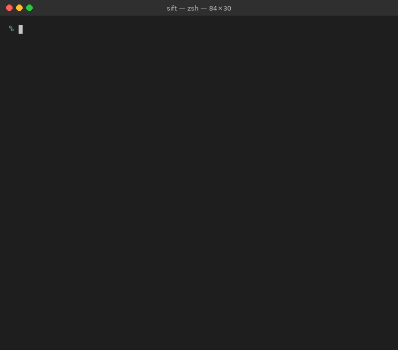
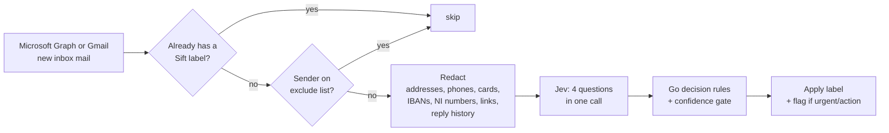

# Sift

**AI email triage for Microsoft 365 and Gmail.** Sift reads new inbox mail and labels each message with an Outlook category or Gmail label. Messages that need attention are also flagged (starred in Gmail), so people can see at a glance what matters.



<sub>Installing on macOS, then running <code>sift demo</code>: a simulated mailbox with simulated Jev answers, using Sift's real redaction, decision rules and triage engine. The animation is rendered from real command output; the email content is fictional. Try it yourself with <code>./sift demo</code>. It needs no credentials and sends nothing anywhere.</sub>

| Label | Colour | Flagged | Meaning |
|---|---|---|---|
| **Sift: Urgent** | red | ✅ | Needs action today: same-day deadline, outage, escalation, regulator, or senior leadership request |
| **Sift: Action Required** | orange | ✅ | The recipient must do or reply to something, but not today |
| **Sift: Meeting** | blue | | Invitations, reschedules, agendas |
| **Sift: FYI** | green | | Informational; nothing to do |
| **Sift: Newsletter** | grey | | Bulk, marketing, automated notifications |
| **Sift: Suspicious** | cranberry | | Likely phishing or fraud: credential requests, bank-detail changes, impersonation |
| **Sift: Review** | yellow | | The model wasn't confident enough to decide, so a human should look |

Sift **only adds categories and flags**. It never moves, deletes, forwards or replies to mail, and it never touches existing categories. In Gmail these appear as `Sift/Urgent`-style labels and stars.

Classification uses **[Jev](https://docs.typesafe.ai/)**, TypeSafe AI's "System One" model. Jev returns typed answers with calibrated confidence instead of free text. A fully self-hosted **Ollama** backend is also included for cases where no mail may leave your network.

---

## Contents

1. [How it works](#how-it-works)
2. [Security and data protection](#security-and-data-protection)
3. [Microsoft 365 setup](#microsoft-365-setup-one-time)
4. [Gmail setup](#gmail-setup-one-time)
5. [Get a Jev API key](#get-a-jev-api-key)
6. [Install on a PC](#install-on-a-pc)
7. [Running on two PCs](#running-on-two-pcs)
8. [First run: dry-run, then live](#first-run-dry-run-then-live)
9. [Keep it running](#keep-it-running)
10. [Configuration reference](#configuration-reference)
11. [Tuning the triage rules](#tuning-the-triage-rules)
12. [Claude Code in this repo](#claude-code-in-this-repo)
13. [Development](#development)
14. [Troubleshooting](#troubleshooting)
15. [Limitations](#limitations)

---

## How it works



Each pass, for every configured mailbox, Sift:

1. **Lists inbox messages** from the last `SIFT_LOOKBACK` (24h by default) using Microsoft Graph or the Gmail API.
2. **Skips** anything that already carries a `Sift:` category. This makes runs idempotent; no local database is kept.
3. **Skips excluded senders** (for example HR or legal). Their mail is never sent to any model.
4. **Redacts** the subject and body (see below), drops quoted reply history and truncates the body to `SIFT_MAX_BODY_CHARS`.
5. **Asks Jev four independent questions** in a single ~100 ms request, as TypeSafe recommends:
   - `category`, a *Choice* between request, meeting, update, newsletter and social
   - `urgency`, a *Score* from 0 (no time pressure) to 2 (needs attention today)
   - `needs_reply`, a *Noul*: is the sender waiting on the recipient?
   - `phishing`, a *Noul*: is this likely phishing or fraud?
6. **Combines the answers in plain Go code** (`internal/classifier/jev.go → Decide`):
   - phishing ≥ 0.7 → **Suspicious**
   - category confidence < `SIFT_JEV_MIN_CONFIDENCE` → **Review**
   - (request or needs-reply ≥ 0.6) and urgency ≥ 1.5 → **Urgent**
   - request or needs-reply ≥ 0.6 → **Action Required**
   - otherwise **Meeting**, **Newsletter** or **FYI** by category
7. **Applies the category** (plus a follow-up flag for Urgent and Action Required).

Because the policy lives in code rather than in a prompt, you can change thresholds and see the effect in unit tests.

### Project layout

```
cmd/sift/              entry point: config, wiring, poll loop
internal/config/       env + sift.env loading and validation (leak guards live here)
internal/graph/        minimal Microsoft Graph client (token, list, read body, tag)
internal/gmail/        minimal Gmail API client and `sift gmail-login` sign-in
internal/redact/       PII / financial identifier redaction
internal/classifier/   Jev and Ollama backends, labels, decision policy
internal/triage/       the engine: skip → redact → classify → tag
internal/demo/         `sift demo`: simulated mailbox + simulated Jev, in-process
scripts/               build + install scripts
docs/                  README assets (demo GIF)
.github/workflows/     CI, releases, Claude Code
```

Sift has **zero third-party Go dependencies**. Everything uses the standard library, which keeps the supply-chain attack surface minimal.

---

## Security and data protection

Email contains commercially sensitive and personal data. Sift is built so that leaks require deliberate misconfiguration, not a typo.

### What leaves your organisation, and where it goes

| Data | Where it goes |
|---|---|
| Mail content (redacted) | **jev backend:** TypeSafe AI's API, `api.typesafe.ai` (processed in the US). **ollama backend:** nowhere off-network |
| Sender address | Never sent. Only the sender's **domain** and an internal/external flag |
| Recipient / mailbox identity | Never sent to the classifier |
| Attachments | Never read |
| Earlier messages in a thread | Stripped before sending |
| Logs | Message and mailbox IDs are **hashed**. Subjects, bodies and addresses are **never logged** |
| Disk | Nothing stored except your `sift.env` config, which holds the Gmail refresh token if you use Gmail |

### Guards built into the code

- **Explicit opt-in for external processing.** The `jev` backend refuses to start unless `SIFT_EXTERNAL_PROCESSING_APPROVED=true`, so nobody can send mail to a third party by accident.
- **HTTPS enforced** for the Jev endpoint.
- **Ollama must be private.** The `ollama` backend refuses any URL that resolves to a public IP unless you override it explicitly.
- **Redaction before classification:** email addresses (domain kept as a phishing signal), phone numbers, Luhn-valid card numbers, IBANs, UK sort code and account numbers, NI numbers, long reference or policy numbers, and URLs (domain kept). Matching deliberately errs towards over-redaction.
- **Prompt-injection containment.** The model can only pick from a fixed label set, so a malicious email can at worst mislabel itself. It cannot trigger actions, read other mail or exfiltrate anything. Jev's typed outputs make an out-of-set answer impossible.
- **Least-privilege mailbox access** (next section): on Microsoft 365, the app can only touch the mailboxes you list. On Gmail, the token covers the one signed-in account, with the broader access described under [Gmail setup](#gmail-setup-one-time).
- **Secrets file protection.** On macOS and Linux, Sift refuses to start if `sift.env` is readable by other users. The Windows installer restricts it to your account. CI fails if `sift.env` is ever committed.
- **No error-body logging.** Error responses from Graph and Jev can echo input, so they are discarded; only status codes are kept.

### ⚠️ Before production: approve the Jev data flow

Jev is a hosted service, so even redacted email text is processed by TypeSafe in the US. That makes TypeSafe a **sub-processor under UK GDPR** and an international transfer. Before setting `SIFT_EXTERNAL_PROCESSING_APPROVED=true`:

- Get sign-off from your **DPO / information security** team.
- Ask TypeSafe for an **enterprise agreement with zero data retention** and a DPA / UK transfer addendum. ZDR is offered to enterprise customers; by default TypeSafe states it does not train on inputs. They also hold SOC 2 Type II (report via their Trust Center). See <https://typesafe.ai/enterprise> and <https://typesafe.ai/legal/data-processing>.
- Ask whether a **VPC / on-prem deployment** is available for your volume.
- If any of that is a no, use `SIFT_BACKEND=ollama` instead. Accuracy is lower, but nothing leaves your network.

---

## Microsoft 365 setup (one-time)

An **Entra ID / M365 admin** needs to do this once. Sift uses the app-only (client credentials) flow, so no user has to sign in.

### 1. Register the app

1. Go to **Entra admin centre → App registrations → New registration**. Name it `Sift Mail Triage`, single tenant, with no redirect URI.
2. Note the **Application (client) ID** and **Directory (tenant) ID**. These become `SIFT_CLIENT_ID` and `SIFT_TENANT_ID`.
3. Go to **Certificates & secrets → New client secret**. Choose a 6–12 month expiry and copy the **value**; this is `SIFT_CLIENT_SECRET`. Put a calendar reminder in for renewal.

### 2. Grant access to only the mailboxes Sift should triage

Don't grant tenant-wide `Mail.ReadWrite` in Entra. That would let the app read **every mailbox in the company**. Instead, use **Exchange Online RBAC for Applications** to scope it.

In Exchange Online PowerShell (`Connect-ExchangeOnline`):

```powershell
# The Enterprise Application's Object ID (Entra → Enterprise applications → Sift Mail Triage)
$appId    = "<SIFT_CLIENT_ID>"
$objectId = "<enterprise app object id>"

# 1. Register the app with Exchange
New-ServicePrincipal -AppId $appId -ObjectId $objectId -DisplayName "Sift Mail Triage"

# 2. A mail-enabled security group holding the people who opt in to Sift
New-DistributionGroup -Name "Sift Users" -Type Security -Members alice@example.com,bob@example.com
$dn = (Get-DistributionGroup "Sift Users").DistinguishedName

# 3. A scope limited to that group
New-ManagementScope -Name "Sift Mailboxes" -RecipientRestrictionFilter "MemberOfGroup -eq '$dn'"

# 4. Grant only mail read/write (+ optional mailbox settings for coloured categories) within that scope
New-ManagementRoleAssignment -App $appId -Role "Application Mail.ReadWrite" -CustomResourceScope "Sift Mailboxes"
New-ManagementRoleAssignment -App $appId -Role "Application MailboxSettings.ReadWrite" -CustomResourceScope "Sift Mailboxes"

# 5. Verify: should be InScope=True for a member, False for anyone else
Test-ServicePrincipalAuthorization -Identity $appId -Resource alice@example.com
Test-ServicePrincipalAuthorization -Identity $appId -Resource ceo@example.com
```

To add or remove people later, change the **Sift Users** group membership. Permission changes can take 30 minutes to two hours to apply.

`MailboxSettings.ReadWrite` is optional. It only lets Sift create the coloured category definitions. Without it, labels still apply, just without colours.

---

## Gmail setup (one-time)

Use this instead of the Microsoft 365 setup for a Gmail or Google Workspace account. You authorise one account by signing in once.

### 1. Create a Google OAuth client

1. In the [Google Cloud console](https://console.cloud.google.com/), create a project, for example `Sift`. This is free.
2. Go to **APIs & Services → Library**, find **Gmail API** and click **Enable**.
3. Go to **Google Auth Platform**. Set up the app with audience **External** and add your address as a contact.
4. Under **Audience**, add your address as a **Test user**. In **Testing** mode Google expires your sign-in after 7 days, so run `sift gmail-login` again each week. To avoid that, click **Publish app**; Google requires a public home page and privacy policy URL on the **Branding** page first.
5. Under **Clients**, create a client of type **Desktop app**. Copy its client ID and secret.

### 2. Configure Sift

In `sift.env`:

```ini
SIFT_MAIL_PROVIDER=gmail
SIFT_GMAIL_CLIENT_ID=...
SIFT_GMAIL_CLIENT_SECRET=...
SIFT_MAILBOXES=you@gmail.com
```

Leave the Microsoft settings empty. `SIFT_INTERNAL_DOMAINS` is optional; leave it empty for a personal account, or use your domain on Google Workspace.

### 3. Sign in

```bash
./sift gmail-login
```

Open the link it prints, on the same computer, and sign in. Google will warn that the app is unverified, which is expected for your own app: choose **Advanced**, then continue. Sift saves `SIFT_GMAIL_REFRESH_TOKEN` to `sift.env`.

### What this access allows

Sift asks for `gmail.modify` because Google has no narrower permission that can both read mail and change labels. That permission would also allow trashing mail. Sift's code only reads messages and adds labels and stars, but **anyone who gets your `sift.env` can use the token against your mailbox**. Keep the file private. To cut off access, remove Sift at <https://myaccount.google.com/permissions>.

### Labelling your whole inbox

Each pass handles up to 100 messages and skips mail that already has a Sift label, so repeated passes work back through older mail. In `sift.env`:

```ini
SIFT_LOOKBACK=200000h
SIFT_MAX_PER_RUN=100
SIFT_CONCURRENCY=8
SIFT_POLL_INTERVAL=5s
```

Leave it running until a pass reports `seen` at 0, then set `SIFT_LOOKBACK=24h` and `SIFT_POLL_INTERVAL=5m`. This covers the Inbox only, not archived mail. With Jev, every message's redacted text goes to TypeSafe, so add sensitive senders to `SIFT_EXCLUDE_SENDERS` first, or use Ollama. Large inboxes can take many hours, and the computer must stay awake.

Gmail handles one account per Sift instance. The API rejects any address other than the signed-in account, so a mistake in `SIFT_MAILBOXES` fails rather than labelling the wrong mail.

---

## Get a Jev API key

1. Request access or sign in at <https://typesafe.ai>. Jev is in early access.
2. Create a key at <https://console.typesafe.ai/keys>.
3. Put it in `sift.env` as `TYPESAFE_API_KEY=...`. **Don't** paste it into code, chat or tickets.

Cost is very low: input is about $0.042 per million tokens and output is free. A typical redacted email is under 1,000 tokens, so 10,000 emails a day costs well under $1/day. Check current pricing in the console.

---

## Install on a PC

Download the archive for your OS from the repo's **Releases** page, or build it with `VERSION=1.0.0 bash scripts/build.sh`, which writes the archives to `dist/`. With Go installed you can also skip installing and run from a clone with `go run ./cmd/sift`.

| PC | File |
|---|---|
| Windows (most PCs) | `sift-<version>-windows-amd64.zip` |
| Windows on ARM (Surface Pro X, Snapdragon laptops) | `sift-<version>-windows-arm64.zip` |
| Mac with Apple silicon (M1–M4) | `sift-<version>-darwin-arm64.tar.gz` |
| Intel Mac | `sift-<version>-darwin-amd64.tar.gz` |
| Linux | `sift-<version>-linux-amd64.tar.gz` |

Verify the download against `SHA256SUMS` on the release page:
`Get-FileHash sift-*.zip` on Windows, or `shasum -a 256 sift-*` on macOS and Linux.

### Windows

1. Unzip the archive.
2. Open PowerShell in the unzipped folder and run:
   ```powershell
   powershell -ExecutionPolicy Bypass -File .\install.ps1
   ```
   This installs to `%LOCALAPPDATA%\Sift`, creates `sift.env` (readable only by you), and registers a scheduled task that starts Sift at logon. Add `-NoAutostart` to skip the task.
3. Open `%LOCALAPPDATA%\Sift\sift.env` in Notepad and fill it in (see [Configuration](#configuration-reference)).

### macOS / Linux

```bash
tar -xzf sift-*-darwin-arm64.tar.gz      # or your file
cd sift-*/
bash install.sh                           # installs to ~/.local/share/sift
nano ~/.local/share/sift/sift.env         # fill in settings
```

---

## Running on two PCs

You can run Sift on as many machines as you like. Avoid having **two machines triage the same mailbox at the same time**: they can both pick up a new message before either has labelled it, and the message ends up classified twice.

**Split the mailboxes between PCs.** Use the same Entra app and the same Jev key on both, but a different `SIFT_MAILBOXES` list on each:

```ini
# PC 1 — sift.env
SIFT_MAILBOXES=alice@example.com,bob@example.com

# PC 2 — sift.env
SIFT_MAILBOXES=carol@example.com,dave@example.com
```

If you instead want the second PC as a **standby**, give it the same list but leave its scheduled task disabled. Only turn it on if PC 1 is down.

Both PCs need outbound HTTPS to `login.microsoftonline.com`, `graph.microsoft.com` and `api.typesafe.ai`.

---

## First run: dry-run, then live

`sift.env.example` ships with `SIFT_DRY_RUN=true` and `SIFT_EXTERNAL_PROCESSING_APPROVED=false` on purpose.

0. Optional: run `./sift demo` to see how labelling works on a simulated mailbox. It needs no setup.
1. Fill in the Microsoft or Gmail settings and the Jev settings. Once approved, set `SIFT_EXTERNAL_PROCESSING_APPROVED=true`.
2. Start with one test mailbox in `SIFT_MAILBOXES`, and set `SIFT_POLL_INTERVAL=` (empty) to run once.
3. Run it from the install folder:
   - Windows: `cd $env:LOCALAPPDATA\Sift; .\sift.exe`
   - macOS/Linux: `cd ~/.local/share/sift && ./sift`
4. Read the output. In dry-run mode, each message is logged with the label it **would** get. Content is not logged, so log lines can't be matched to individual messages. Check the label counts here, then review the real labels in step 5:
   ```json
   {"level":"INFO","msg":"dry-run","mailbox":"3fa1…","msg":"9c2e…","label":"urgent","confidence":0.92,"flag":true,"reason":"action needed, urgency 1.8/2"}
   {"level":"INFO","msg":"pass complete","seen":31,"tagged":28,"skipped":0,"excluded":3,"failed":0,"by_label":{...}}
   ```
5. When you're happy, set `SIFT_DRY_RUN=false` and run again. The labels appear in Outlook or Gmail (web, desktop and mobile) within seconds.
6. Set `SIFT_POLL_INTERVAL=5m`, add the remaining mailboxes, and leave it running.

---

## Keep it running

| OS | How |
|---|---|
| **Windows** | `install.ps1` registers the **"Sift Mail Triage"** scheduled task (at logon, restarts on failure). Manage it in Task Scheduler. To run without anyone logged in, edit the task to *Run whether user is logged on or not*. |
| **macOS** | Create a LaunchAgent (below). |
| **Linux** | Create a systemd user service (below). |

**macOS** (`~/Library/LaunchAgents/io.github.reaper1994.sift.plist`):

```xml
<?xml version="1.0" encoding="UTF-8"?>
<!DOCTYPE plist PUBLIC "-//Apple//DTD PLIST 1.0//EN" "http://www.apple.com/DTDs/PropertyList-1.0.dtd">
<plist version="1.0"><dict>
  <key>Label</key><string>io.github.reaper1994.sift</string>
  <key>ProgramArguments</key><array><string>/Users/YOU/.local/share/sift/sift</string></array>
  <key>WorkingDirectory</key><string>/Users/YOU/.local/share/sift</string>
  <key>RunAtLoad</key><true/>
  <key>KeepAlive</key><true/>
  <key>StandardOutPath</key><string>/Users/YOU/.local/share/sift/sift.log</string>
  <key>StandardErrorPath</key><string>/Users/YOU/.local/share/sift/sift.log</string>
</dict></plist>
```

Load it with `launchctl load ~/Library/LaunchAgents/io.github.reaper1994.sift.plist`.

**Linux** (`~/.config/systemd/user/sift.service`):

```ini
[Unit]
Description=Sift mail triage
After=network-online.target

[Service]
WorkingDirectory=%h/.local/share/sift
ExecStart=%h/.local/share/sift/sift
Restart=on-failure
RestartSec=30
NoNewPrivileges=yes

[Install]
WantedBy=default.target
```

Enable it with `systemctl --user enable --now sift`, and view logs with `journalctl --user -u sift -f`.

For a server or Kubernetes deployment, run with `SIFT_POLL_INTERVAL` empty as a cron job or CronJob, and inject secrets from Key Vault as environment variables instead of using `sift.env`.

---

## Configuration reference

Settings come from environment variables, or from `sift.env` in the working directory or next to the binary (`SIFT_ENV_FILE` overrides the path). Real environment variables take precedence over the file.

| Variable | Default | Description |
|---|---|---|
| `SIFT_MAIL_PROVIDER` | `m365` | `m365` or `gmail` |
| `SIFT_TENANT_ID` | required for m365 | Entra tenant ID |
| `SIFT_CLIENT_ID` | required for m365 | App registration client ID |
| `SIFT_CLIENT_SECRET` | required for m365 | App client secret |
| `SIFT_GMAIL_CLIENT_ID` | required for gmail | Google OAuth desktop client ID |
| `SIFT_GMAIL_CLIENT_SECRET` | required for gmail | Google OAuth desktop client secret |
| `SIFT_GMAIL_REFRESH_TOKEN` | required for gmail | Saved by `sift gmail-login` |
| `SIFT_MAILBOXES` | **required** | Comma-separated mailboxes this instance triages; one address for gmail |
| `SIFT_INTERNAL_DOMAINS` | required for m365 | Your domains, e.g. `example.com`; subdomains count as internal |
| `SIFT_EXCLUDE_SENDERS` | | Domains or addresses never sent to the classifier |
| `SIFT_BACKEND` | `jev` | `jev` or `ollama` |
| `TYPESAFE_API_KEY` | required for jev | Jev API key |
| `SIFT_JEV_MODEL` | `jev-latest` | Pin a version (e.g. `jev-1.13`) for stable behaviour |
| `SIFT_JEV_MIN_CONFIDENCE` | `0.5` | Below this, the message is labelled **Review** |
| `SIFT_JEV_URL` | `https://api.typesafe.ai` | API base URL (must be https) |
| `SIFT_EXTERNAL_PROCESSING_APPROVED` | `false` | Must be `true` to use jev |
| `SIFT_OLLAMA_URL` | `http://127.0.0.1:11434` | Must be private unless overridden |
| `SIFT_OLLAMA_MODEL` | `llama3.1:8b` | Any Ollama model that supports structured outputs |
| `SIFT_ALLOW_REMOTE_OLLAMA` | `false` | Allow a public Ollama URL (not recommended) |
| `SIFT_DRY_RUN` | `false` | Log labels without changing mail |
| `SIFT_POLL_INTERVAL` | *(run once)* | e.g. `5m`; empty means one pass then exit |
| `SIFT_LOOKBACK` | `24h` | How far back to look for unlabelled mail |
| `SIFT_MAX_PER_RUN` | `50` | Max messages per mailbox per pass (≤100) |
| `SIFT_MAX_BODY_CHARS` | `3000` | Body truncation after redaction |
| `SIFT_CONCURRENCY` | `4` | Parallel classifications (1–16); Gmail message fetches use the same value, capped at 8 |
| `SIFT_FLAG` | `true` | Flag Urgent / Action Required for follow-up (a star in Gmail) |

Commands: `sift` (triage using `sift.env`), `sift demo` (simulated mailbox; no credentials, no network), `sift gmail-login` (sign in to Gmail and save the token), `sift version`, `sift help`.

Exit codes: `0` success, `1` a single-run pass had failures, `2` invalid configuration or unknown command.

---

## Tuning the triage rules

- **Thresholds and logic:** `Decide` in `internal/classifier/jev.go`. Each case has a test in `classifier_test.go`; add a case before changing behaviour.
- **What the model is asked:** `jevQuestions` in the same file. Keep each question atomic (one judgment per question, per TypeSafe's guidance). Add a new question rather than overloading an existing one.
- **Domain context:** add your own industry's vocabulary (project names, document types, client terms) to the criteria descriptions so the model knows what counts as a request in your world.
- **Too many Reviews?** Lower `SIFT_JEV_MIN_CONFIDENCE` (say to 0.4). **Too many wrong labels?** Raise it.

---

## Claude Code in this repo

`.github/workflows/claude.yml` runs the [Claude Code GitHub Action](https://github.com/anthropics/claude-code-action):

- **@claude** in any issue or PR comment: Claude answers, reviews or pushes fixes.
- **Every PR** from this repo gets an automatic review that focuses on correctness and data protection.

Setup:

1. Install the Claude GitHub app on the repo. The quickest way is to run `/install-github-app` in Claude Code; otherwise go to <https://github.com/apps/claude>.
2. Add the repository secret **`ANTHROPIC_API_KEY`** under Settings → Secrets and variables → Actions.

Only **source code** is sent to Anthropic by this workflow. Sift's mailbox data never passes through CI.

---

## Development

Requires Go 1.24+.

```bash
go test -race ./...        # unit tests (no network; Graph and Jev are faked)
go vet ./...
./scripts/build.sh         # cross-compile all platforms into dist/
VERSION=v0.1.0 ./scripts/build.sh
```

To cut a release, either run `git tag v0.1.0 && git push --tags`, or on GitHub go to **Releases → Draft a new release**, type a new tag such as `v0.1.0` targeting `main`, and publish. Either way, the Release workflow builds every platform and attaches the archives and checksums to that release within a few minutes.

CI runs gofmt, vet, race-enabled tests, `govulncheck`, and a check that no `sift.env` was committed.

---

## Troubleshooting

| Symptom | Fix |
|---|---|
| `invalid configuration … SIFT_EXTERNAL_PROCESSING_APPROVED` | Intended. Get approval, then set it to `true`, or use `SIFT_BACKEND=ollama` |
| `token request failed: 401` | Wrong tenant, client ID or secret, or the secret has expired |
| `graph … 403 ErrorAccessDenied` | The mailbox is not in the RBAC scope (check **Sift Users** membership, wait up to 2 h) |
| `could not create coloured category` warning | `MailboxSettings.ReadWrite` is not granted. Labels still work, without colours |
| `jev: 401 Unauthorized` | Bad or revoked `TYPESAFE_API_KEY` |
| `jev: 429` / `529` repeatedly | Rate-limited or overloaded. Sift already retries with backoff; lower `SIFT_CONCURRENCY` or ask TypeSafe for higher limits |
| `sift.env … readable by other users` (macOS/Linux) | `chmod 600 sift.env` |
| macOS says the app "can't be opened" | `xattr -d com.apple.quarantine ~/.local/share/sift/sift` (the installer does this for you) |
| Windows SmartScreen warning | The binary is unsigned. Choose *More info → Run anyway*, or have IT sign it |
| `invalid_grant` from Google | Run `sift gmail-login` again. If it recurs every 7 days, publish the OAuth app to production |
| Google `403: access_denied` at sign-in | The OAuth app is in Testing: add your address under **Test users** |
| `gmail … accessNotConfigured` | Enable the Gmail API in the project your OAuth client belongs to, then wait a minute |
| `gmail … 403 PERMISSION_DENIED` | Make `SIFT_MAILBOXES` the signed-in address, and approve the Gmail permission at sign-in |
| A message got the wrong label | Remove the `Sift:` category or `Sift/` label; it will be re-triaged on the next pass. Tune via [Tuning](#tuning-the-triage-rules) |

---

## Limitations

- Triage is advisory. People should still read their mail; **Suspicious** does not replace your mail security gateway.
- Only the **Inbox** folder is scanned. Mail moved by inbox rules before Sift runs is not labelled.
- Redaction is pattern-based. It catches common identifiers, not every possible piece of personal data (names in free text are not removed, for example). Approve the Jev data flow with that in mind.
- Gmail covers one account per Sift instance. Run a separate instance, with its own `sift.env`, for each extra account.
- Client-secret authentication only; certificate auth is a good next step for production.
- Jev is early-access software. Pin `SIFT_JEV_MODEL` to a specific version once you're happy with the behaviour.
